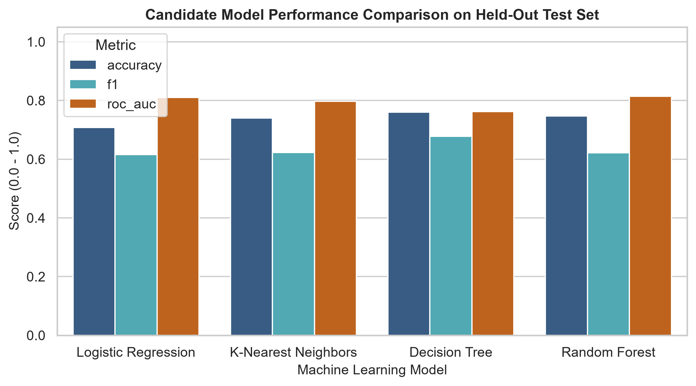
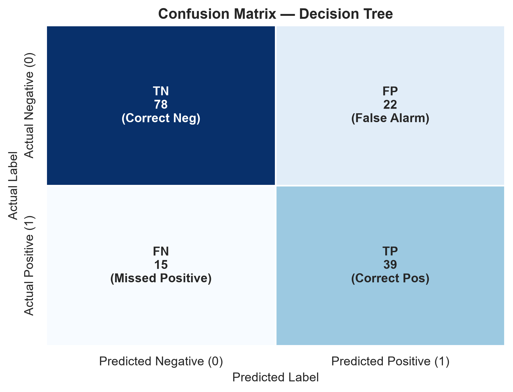
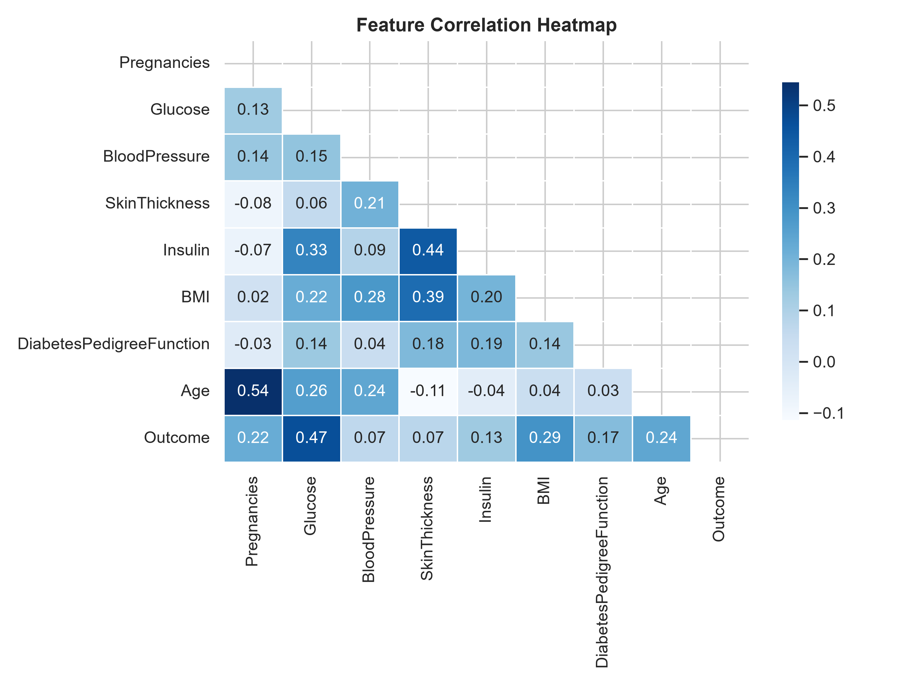

# Diabetes Risk Prediction Using Machine Learning

> **Medical & Educational Disclaimer:**
> This repository is an educational machine learning mini-project created for academic demonstration. Predictions generated by the models reflect statistical patterns discovered in the training dataset and **must not** be considered medical advice, clinical diagnoses, or clinical decision support tools.

---

## Project Overview
This project presents an end-to-end, leak-free Machine Learning system for predicting binary diabetes risk (`Outcome`: 0 = Negative, 1 = Positive) from physiological and diagnostic patient measurements. Developed with academic rigor, the project demonstrates sound data validation, treatment of hidden missing values, exploratory data analysis, stratified 5-fold cross-validation, hyperparameter tuning, model comparison, feature importance analysis, and an interactive Streamlit web application.

---

## Problem Statement
Type 2 diabetes often develops asymptomatically over several years. While early identification can support timely preventative lifestyle interventions, raw diagnostic datasets frequently suffer from collection anomalies (such as biologically implausible zeros) and class imbalance. The objective of this project is to build a reproducible supervised classification pipeline that addresses these challenges without data leakage, comparing multiple algorithms to identify the most robust model for risk pattern detection.

---

## Objectives
1. **Acquire & Validate Data:** Examine the public Pima Indians Diabetes dataset, verifying data types, distributions, and missing value representations.
2. **Prevent Data Leakage:** Ensure test sets remain strictly untouched during imputer learning, feature scaling, and hyperparameter selection.
3. **Handle Biologically Implausible Zeros:** Replace zeros in features where zero is physiologically impossible (`Glucose`, `BloodPressure`, `SkinThickness`, `Insulin`, `BMI`) with training-derived median values.
4. **Compare Multiple Classifiers:** Evaluate Logistic Regression, K-Nearest Neighbors, Decision Trees, and Random Forests.
5. **Stratified 5-Fold Cross-Validation:** Validate model stability on training folds to prevent overfitting.
6. **Deploy an Interactive Application:** Deliver a clean Streamlit interface with preset test profiles, real-time predictions, probability scores, and diagnostic metrics.

---

## Dataset
- **Name:** Pima Indians Diabetes Database
- **Origin / Source:** National Institute of Diabetes and Digestive and Kidney Diseases (NIDDK), hosted via UCI Machine Learning Repository
- **Instances (Rows):** 768
- **Attributes (Columns):** 8 numerical predictors + 1 binary target
- **Target Variable:** `Outcome` (0 = Negative / Non-diabetic [500 records, 65.1%], 1 = Positive / Diabetic [268 records, 34.9%])

---

## Dataset Features

| Feature Name | Description | Observed Min | Observed Max | Missing Zero Treatment |
|---|---|---|---|---|
| `Pregnancies` | Number of times pregnant | 0 | 17 | Valid 0 (Nulliparous) |
| `Glucose` | Plasma glucose concentration (2-hr oral glucose tolerance test) | 0 (imputed) | 199 mg/dL | Implausible 0 treated as missing |
| `BloodPressure` | Diastolic blood pressure | 0 (imputed) | 122 mm Hg | Implausible 0 treated as missing |
| `SkinThickness` | Triceps skin fold thickness | 0 (imputed) | 99 mm | Implausible 0 treated as missing |
| `Insulin` | 2-Hour serum insulin | 0 (imputed) | 846 μU/ml | Implausible 0 treated as missing |
| `BMI` | Body mass index (weight in kg / (height in m)²) | 0 (imputed) | 67.1 kg/m² | Implausible 0 treated as missing |
| `DiabetesPedigreeFunction` | Genetic pedigree risk score based on family history | 0.078 | 2.42 | Continuous positive score |
| `Age` | Age of patient in years | 21 | 81 | Continuous integer |
| `Outcome` | Target binary indicator | 0 | 1 | 0 = Negative, 1 = Positive |

---

## Project Workflow

```text
DATASET (data/diabetes.csv)
       │
       ▼
DATA VALIDATION (Inspect data types, distributions, and zeros)
       │
       ▼
EXPLORATORY DATA ANALYSIS (Distributions, class balance, correlation heatmap)
       │
       ▼
TRAIN / TEST SPLIT (80% Train [614 rows] / 20% Held-Out Test [154 rows], stratify=y, seed=42)
       │
       ▼
PREPROCESSING PIPELINE (ColumnTransformer: Median Imputer + StandardScaler)
       │
       ▼
MODEL TRAINING & 5-FOLD STRATIFIED CROSS-VALIDATION
  ├── Logistic Regression
  ├── K-Nearest Neighbors
  ├── Decision Tree
  └── Random Forest
       │
       ▼
HYPERPARAMETER TUNING (GridSearchCV on training folds)
       │
       ▼
MODEL COMPARISON & FINAL SELECTION (Decision Tree selected for highest F1 & Recall)
       │
       ▼
FINAL TEST SET EVALUATION (Unseen test set: Accuracy 75.97%, F1 0.6783, Recall 72.22%)
       │
       ▼
PIPELINE SERIALIZATION (models/best_model.pkl, metrics.json, metadata.json)
       │
       ▼
STREAMLIT WEB APPLICATION (Multi-page interface for prediction & viva demo)
```

---

## Exploratory Data Analysis
Key observations from actual data:
- **Class Imbalance:** 65.1% negative (class 0) vs. 34.9% positive (class 1). Stratified sampling was essential.
- **Biologically Implausible Zeros:** 5 zeros in Glucose, 35 in Blood Pressure, 227 in Skin Thickness, 374 in Insulin, and 11 in BMI.
- **Correlations:** Glucose showed the strongest individual positive correlation with the outcome ($r \approx 0.47$), followed by BMI ($r \approx 0.29$) and Age ($r \approx 0.24$).

---

## Data Preprocessing
- **Leak-Free Isolation:** Imputer medians and scaler means/variances were fitted strictly on the training partition (`X_train`) inside a `ColumnTransformer`.
- **Targeted Imputation:** `SimpleImputer(missing_values=0, strategy='median')` was restricted strictly to the 5 features containing implausible zeros. `Pregnancies` was preserved without modifying valid zeros.
- **Unified Pipeline:** Feature transformation and model estimation are packaged into a single `Pipeline` object, ensuring that raw incoming user data is preprocessed identically in both training and production.

---

## Machine Learning Models
Four supervised algorithms were trained and evaluated:
1. **Logistic Regression:** Linear probabilistic classifier with L2 regularization.
2. **K-Nearest Neighbors (KNN):** Non-parametric instance-based classifier.
3. **Decision Tree Classifier:** Interpretable non-linear tree partitioned via Gini impurity (`max_depth=5`).
4. **Random Forest Classifier:** Ensemble of bootstrap bagged decision trees with feature subsampling.

---

## Model Evaluation & Comparison

### Held-Out Test Set Results (Actual Project Metrics)

| Model | 5-Fold CV F1 | Test Accuracy | Test Precision | Test Recall | Test F1-Score | Test ROC-AUC |
|---|---|---|---|---|---|---|
| **Decision Tree** | 0.5866 | **75.97%** | **63.93%** | **72.22%** | **0.6783** | **0.7622** |
| **Random Forest** | 0.6536 | 74.68% | 65.31% | 59.26% | 0.6214 | 0.8146 |
| **K-Nearest Neighbors** | 0.6366 | 74.03% | 63.46% | 61.11% | 0.6226 | 0.7969 |
| **Logistic Regression** | 0.6823 | 70.78% | 57.14% | 66.67% | 0.6154 | 0.8104 |

---

## Final Model Selection
**Selected Model:** `Decision Tree Classifier (max_depth=5)`

### Selection Rationale:
In medical screening contexts, detecting true positive cases is paramount. While Random Forest and Logistic Regression achieved high ROC-AUC scores, the Decision Tree achieved the highest **Recall (72.22%)** and highest **F1-Score (0.6783)** on held-out test data, correctly identifying 39 out of 54 actual positive cases with only 15 false negatives. Furthermore, a constrained Decision Tree provides complete visual and rule-based interpretability, making it ideal for academic discussion and clinical auditing.

### Final Confusion Matrix (Test Set: N = 154)
- **True Negatives (TN):** 78 (Correct negative predictions)
- **False Positives (FP):** 22 (False alarms)
- **False Negatives (FN):** 15 (Missed positive cases)
- **True Positives (TP):** 39 (Correct positive predictions)

---

## Streamlit Application
The project includes a multi-page interactive web interface built with Streamlit:
- **Home:** Project goals, architecture diagram, selected model summary, and disclaimer.
- **Data Analysis:** Dataset explorer, zero-value analysis table, and interactive EDA plots.
- **Risk Prediction:** Form with preset sample profiles, real-time pipeline inference, and probability scores.
- **Model Performance:** Comprehensive metric tables, confusion matrix breakdown, ROC curves, and feature importance.
- **About Project:** Problem statement, academic framing, limitations, and future scope.

---

## Project Structure

```text
diabetes-risk-prediction/
│
├── data/
│   └── diabetes.csv                    # Raw verified public benchmark dataset
│
├── models/
│   ├── best_model.pkl                  # Serialized complete scikit-learn pipeline
│   ├── model_metrics.json              # Empirical evaluation & CV metrics
│   └── feature_metadata.json           # Feature schema & safe input bounds
│
├── notebooks/
│   └── diabetes_analysis.ipynb         # Comprehensive Jupyter analysis notebook
│
├── outputs/
│   └── figures/                        # Generated high-resolution diagnostic plots
│       ├── class_distribution.png
│       ├── correlation_heatmap.png
│       ├── glucose_distribution.png
│       ├── bmi_distribution.png
│       ├── age_distribution.png
│       ├── confusion_matrix.png
│       ├── roc_curve.png
│       ├── feature_importance.png
│       └── model_comparison.png
│
├── screenshots/                        # Visual assets for documentation
│       ├── model_performance.png
│       ├── confusion_matrix.png
│       └── correlation_heatmap.png
│
├── src/
│   ├── __init__.py                     # Package initialization
│   ├── data_utils.py                   # Loading, quality checks, and EDA plots
│   ├── preprocess.py                   # Leak-free ColumnTransformer & Pipeline
│   ├── evaluate.py                     # Metric calculation & visualization functions
│   └── train_model.py                  # Training orchestrator & hyperparameter tuning
│
├── tests/
│   └── test_project.py                 # Automated sanity and assertion test suite
│
├── app.py                              # Streamlit web application
├── requirements.txt                    # Project dependencies
├── README.md                           # Project documentation
├── .gitignore                          # Git ignore specification
└── LICENSE                             # MIT Open Source License
```

---

## Technologies Used
- **Programming Language:** Python 3.13
- **Data Manipulation:** `pandas`, `numpy`
- **Machine Learning:** `scikit-learn` (Pipelines, ColumnTransformer, Imputer, Scaler, Models, GridSearchCV, Metrics)
- **Data Visualization:** `matplotlib`, `seaborn`
- **Model Persistence:** `joblib`, `json`
- **Application Framework:** `streamlit`
- **Version Control:** `git`, `GitHub`

---

## Installation & How to Run

### 1. Clone the Repository
```bash
git clone <YOUR_ACTUAL_REPOSITORY_URL>
cd diabetes-risk-prediction
```

### 2. Create and Activate Virtual Environment
```powershell
# Windows PowerShell
python -m venv .venv
.\.venv\Scripts\Activate.ps1
```

```bash
# macOS / Linux
python3 -m venv .venv
source .venv/bin/activate
```

### 3. Install Dependencies
```bash
pip install -r requirements.txt
```

### 4. Re-Train Models (Optional)
```bash
python -m src.train_model
```

### 5. Run Automated Tests
```bash
python tests/test_project.py
```

### 6. Launch the Streamlit Web Application
```bash
streamlit run app.py
```
Open your browser at `http://localhost:8501`.

---

## Screenshots

### Candidate Model Comparison


### Final Confusion Matrix


### Feature Correlation Heatmap


---

## Limitations
1. **Sample Size:** 768 patient instances is relatively small for generalized predictive modeling.
2. **Demographic Specificity:** The cohort comprises exclusively females of Pima Indian heritage aged 21 and above. Patterns may not generalize across broader ethnic, age, and gender populations.
3. **Missing Value Imputation:** While median imputation within folds avoids leakage, modern multi-imputation (MICE) or domain-specific clinical models could capture higher-order relationships.

---

## Future Scope
- Integration of larger, diverse multi-center electronic health record (EHR) cohorts.
- Exploration of gradient boosted tree architectures (XGBoost, LightGBM, CatBoost) with SHAP (SHapley Additive exPlanations) interpretability.
- Inclusion of longitudinal health variables and dietary/activity biomarkers.

---

## Disclaimer
This software application is provided strictly for academic and educational purposes. It is not intended to provide medical advice, diagnosis, or treatment. Always consult qualified healthcare professionals regarding medical questions.

---

## Author
Academic Machine Learning Project Contributor  
*Prepared for Academic Mini-Project Submission and Viva Voce Examination.*
